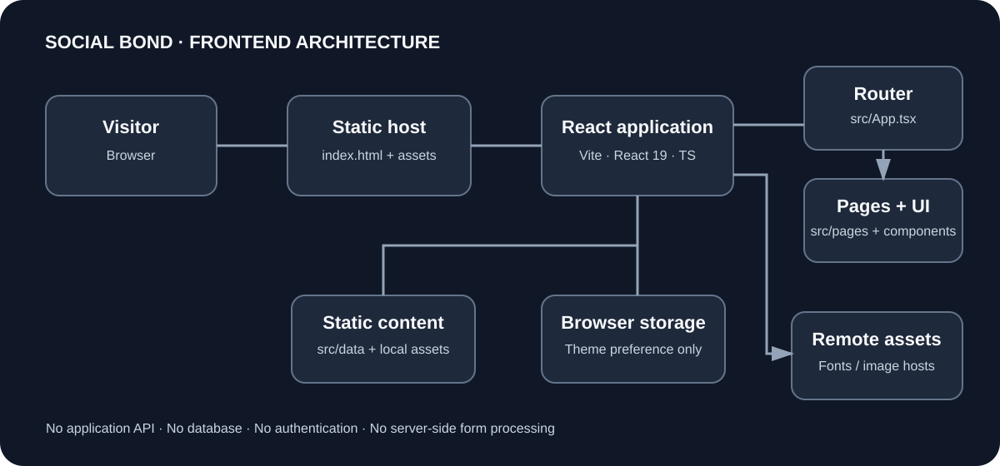
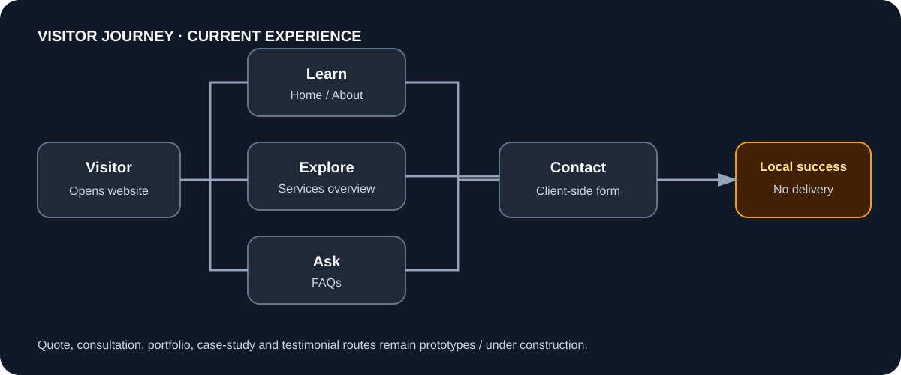
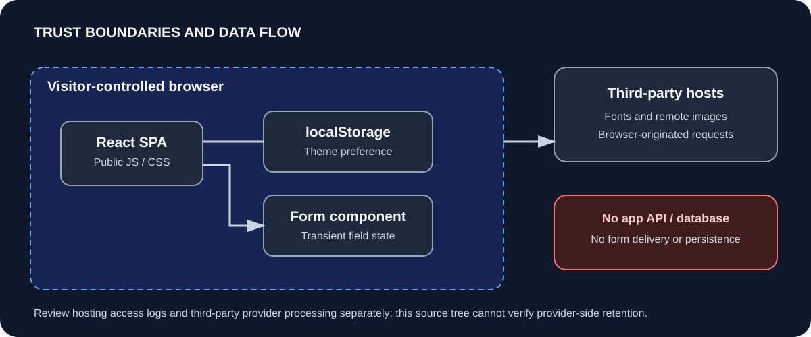

# 🤝 Social Bond Website

<p align="center"></p>
<p align="center">


</p>

**Social Bond** is a React-based marketing website stored in the `Brajesh31/bondforge-studio` repository. It is a client-side single-page application built with React, TypeScript, Vite and Tailwind CSS.

> [!IMPORTANT]
> **Implementation status:** this is a frontend prototype/in-progress website. It has no application API, database, authentication or server-side form processing. Several lead-generation, portfolio and proof-of-work routes are prototypes. A local form confirmation is not message delivery. Read [Known limitations](docs/known-limitations.md) before treating this as a production lead-generation platform.

## 🧭 Contents
- [Overview](#-overview) · [Technology](#-technology) · [Implementation](#-current-implementation)
- [Routes](#-routes) · [Architecture](#-architecture) · [Run locally](#️-run-locally)
- [Repository structure](#️-repository-structure) · [Security](#-security-and-privacy)
- [Accessibility](#-accessibility) · [Quality](#-quality-and-verification) · [Documentation](#-documentation)

## ✨ Overview

The website presents company information, a services overview, FAQs, contact information and policy content through a browser-rendered React interface. Shared navigation, footer, page sections and UI primitives are composed from reusable components.



| Area | Current state |
|---|---|
| Home, About, Services overview | Frontend pages |
| Contact | Client-side form state and local confirmation only |
| FAQs and policy pages | Static frontend content |
| Theme | Browser preference stored in `localStorage` |
| Consultation / quote | Prototype, no real provider or submission |
| Portfolio / case studies / testimonials | Under-construction experiences |
| Backend / database / authentication | Not present |
| Automated test suite | Not configured |

## 🧰 Technology

| Layer | Technology |
|---|---|
| UI | React 19, TypeScript |
| Build/dev server | Vite 7 |
| Styling | Tailwind CSS 4 |
| Routing | React Router DOM 7 |
| UI primitives | Radix UI |
| Forms/utilities | React Hook Form, Zod and React state where used |
| Motion/charts | Framer Motion / Motion, Recharts |
| Package manager | Bun with committed `bun.lock` |

## 🚦 Current implementation

- Active route table: `src/App.tsx`.
- React root and providers: `src/main.tsx`.
- Static page content and navigation data are held in TypeScript.
- The contact form does not send an HTTP request, open an email client or persist a submission.
- Consultation controls do not connect to a calendar provider.
- No CRM, newsletter, analytics, authentication or server API integration is established by the current source.
- Google Fonts and remote image/avatar hosts are referenced by the browser. Review [External dependencies](docs/external-dependencies.md).

Do not ask visitors to submit confidential information through a form that has no delivery path. Do not describe static policy copy as an implemented consent or deletion system.

## 🗺️ Routes

| Path | Current state |
|---|---|
| `/`, `/about`, `/services`, `/contact`, `/faqs` | Implemented frontend pages |
| `/privacy-policy`, `/cookie-policy`, `/terms` | Static policy content |
| Four `/services/...` detail routes | Prototype / under construction |
| `/portfolio`, `/case-studies`, `/testimonials` | Prototype / under construction |
| `/free-consultation`, `/request-a-quote` | Prototype / no connected workflow |
| Any unknown path | Catch-all 404 |

See [Route catalogue](docs/route-catalogue.md) and [Routes and integrations](docs/api.md).

## 🏗️ Architecture



The browser loads a static Vite build. React Router selects route components. The UI consumes bundled content and assets, stores the theme preference locally, and may request remote fonts/images. There is no application API or database.

## ⚙️ Run locally

**Requirements:** Bun and a runtime compatible with Vite 7.

```bash
git clone https://github.com/Brajesh31/bondforge-studio.git
cd bondforge-studio
bun install --frozen-lockfile
bun run dev
```

Vite is configured for port `8080`. Open the local URL printed by the command, typically `http://localhost:8080`.

## 📜 Commands

| Command | Purpose |
|---|---|
| `bun install --frozen-lockfile` | Install locked dependencies |
| `bun run dev` | Start Vite |
| `bun run lint` | Run ESLint |
| `bun run build` | Create production assets |
| `bun run preview` | Preview `dist/` |
| `python scripts/validate-doc-links.py` | Validate local Markdown links |
| `python scripts/validate-project-structure.py` | Check required repository paths |

There is no test script or configured automated test runner. See [Quality gates](docs/quality-gates.md).

## 🗂️ Repository structure

- `.github/`: issue forms, PR template and GitHub Actions.
- `docs/`: engineering handbook, templates and original diagrams.
- `public/`: static public assets.
- `scripts/`: documentation and structure validators.
- `src/assets/`: imported image assets.
- `src/components/sections/`: shared page sections, navigation and footer.
- `src/components/ui/`: reusable UI primitives.
- `src/data/`: static content and page metadata.
- `src/hooks/`: shared React hooks.
- `src/lib/`: utilities and router compatibility shim.
- `src/pages/`: route-level pages and page sections.
- `src/App.tsx`: active route table.
- `src/main.tsx`: React entry point.
- `src/styles.css`: global styles and theme tokens.

See [Project structure](docs/project-structure.md) for file ownership and boundaries.

## 🔐 Security and privacy

- Never place private credentials in `VITE_*` variables. Vite exposes these values to the browser bundle.
- The current app reads no application-specific environment variables.
- Theme preference is stored in browser `localStorage`.
- The contact form is local-only and does not transmit values.
- Review remote font/image requests and hosting-provider logs separately.
- Report vulnerabilities using the private process in [SECURITY.md](SECURITY.md), not a public issue.

See [Security](docs/security.md), [Threat model](docs/threat-model.md), [Privacy inventory](docs/privacy-data-inventory.md) and [Incident response](docs/incident-response.md).

## ♿ Accessibility

Use WCAG 2.2 AA as the engineering target for new and revised UI. No blanket conformance claim is made. Review keyboard operation, visible focus, labels, errors, contrast, screen-reader behavior, zoom/reflow and reduced motion.

- [Accessibility guide](docs/accessibility.md)
- [Accessibility test plan](docs/accessibility-testing.md)
- [Audit template](docs/templates/accessibility-audit-template.md)

## 🧪 Quality and verification

The current CI workflow installs dependencies with Bun, runs ESLint and builds the production app. Documentation validation checks local relative links and required repository paths. There is no unit, integration or browser E2E suite yet.

```bash
bun install --frozen-lockfile
bun run lint
bun run build
python scripts/validate-doc-links.py
python scripts/validate-project-structure.py
```

A passing build is not proof of accessibility, security, privacy or production readiness. See [QA](docs/qa.md).

## 📚 Documentation

| Guide | Contents |
|---|---|
| [Engineering handbook](docs/README.md) | Documentation index |
| [Product overview](docs/product-overview.md) | Scope and capabilities |
| [Requirements](docs/requirements.md) | Functional and non-functional requirements |
| [Architecture](docs/architecture.md) | Runtime and components |
| [Project structure](docs/project-structure.md) | Directory and file ownership |
| [Route catalogue](docs/route-catalogue.md) | Browser paths and status |
| [User journeys](docs/user-journeys.md) | Visitor flows |
| [Installation](docs/installation.md) | Setup |
| [Development](docs/development.md) | Contribution workflow |
| [Configuration](docs/environment-and-configuration.md) | Environment and build config |
| [External dependencies](docs/external-dependencies.md) | Packages and browser requests |
| [Deployment](docs/deployment.md) | Static hosting |
| [Security](docs/security.md) | Frontend controls |
| [Privacy inventory](docs/privacy-data-inventory.md) | Current data handling |
| [Accessibility](docs/accessibility.md) | Inclusive UI requirements |
| [Performance](docs/performance.md) | Measurement and optimization |
| [Error handling](docs/error-handling.md) | Failure and recovery |
| [Operations](docs/operations.md) | Operations guidance |
| [Monitoring](docs/monitoring-and-observability.md) | Static-site observability |
| [Backup and recovery](docs/backup-and-recovery.md) | Recovery process |
| [Known limitations](docs/known-limitations.md) | Verified gaps |
| [Templates](docs/templates/README.md) | Reusable templates |

## 🤝 Contributing

Read [CONTRIBUTING.md](CONTRIBUTING.md), follow the [Code of Conduct](CODE_OF_CONDUCT.md), and use the issue forms for reproducible reports. Keep changes focused, preserve existing application assets, and update documentation whenever behavior changes.

## 📄 License

This project is distributed under the MIT License. See [LICENSE](LICENSE) for the complete terms.
