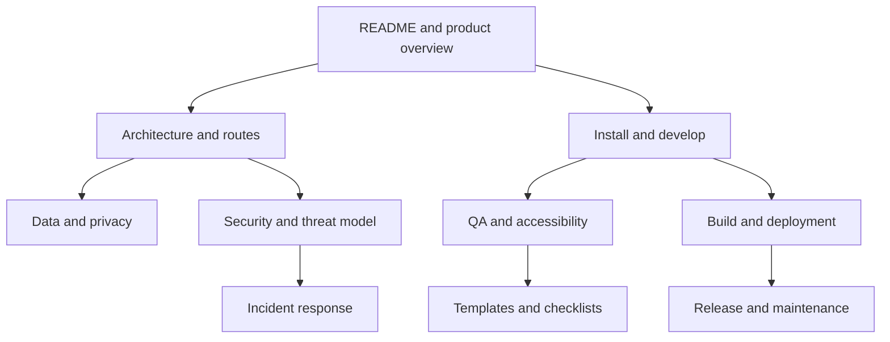

# 📚 Social Bond Engineering Handbook

Welcome to the engineering documentation for **Social Bond**, the marketing website stored in `bondforge-studio`.

> [!IMPORTANT]
> This is a frontend-only React application. It has no server API, database, authentication, or server-side form processing. Several visible routes and actions are prototypes. Read [Product overview](product-overview.md) before presenting the site as a production lead-generation platform.

## 🧭 Start here

| Goal | Guide |
| --- | --- |
| Understand current capability | [Product overview](product-overview.md) |
| Understand component and route boundaries | [Architecture](architecture.md) |
| Install and run locally | [Installation](installation.md) |
| Make safe changes | [Development](development.md) |
| Understand every browser route | [Route catalogue](api.md) |
| Understand state and data | [Data and persistence](database.md) |
| Prepare static deployment | [Deployment](deployment.md) |
| Review security | [Security](security.md) and [Threat model](threat-model.md) |
| Build accessible experiences | [Accessibility](accessibility.md) |
| Verify quality | [QA](qa.md) |
| Operate and maintain | [Operations](operations.md), [Maintenance](maintenance.md) |

## 🗺️ Documentation map

## 🧩 Product and implementation boundaries

The website includes home, company content, service overview, contact, FAQs, and policy pages. The active route table is in `src/App.tsx`. The page-plan catalogue in `src/data/site-pages.ts` describes content intentions and is not proof that every page is implemented.

Known prototype boundaries:
- The contact form displays a local success state and does not send or save submissions.
- The consultation picker is mock UI and has no calendar provider.
- Quote, portfolio, case-study, testimonial, and detailed service routes contain under-construction experiences.
- Static privacy and cookie policy copy does not implement consent or data-subject workflows.
- No test runner or automated test suite is configured at present.

## 🧱 Source of truth

When docs and code disagree, inspect the current source first. Key files include `src/main.tsx`, `src/App.tsx`, `vite.config.ts`, `src/lib/router-shim.tsx`, and `src/pages/`. Update the matching guide whenever behavior changes.

## ✍️ Contribution standard

A useful change explains the visitor problem, preserves existing behavior unless intentionally changed, includes keyboard and responsive checks, and records security/privacy consequences. Use the templates in [docs/templates](templates/README.md).