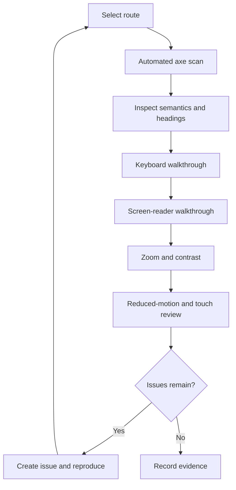

# ♿ Accessibility Engineering Guide

Accessibility is an implementation requirement, not a badge or claim. This guide does not certify conformance.

## Target
Use WCAG 2.2 AA as the engineering target for new/revised interfaces. Verify criteria against rendered pages and assistive technology before claiming conformance.

## Interaction principles
- Every interactive control must be keyboard reachable and operable.
- Focus must be visible and not hidden beneath sticky navigation or overlays.
- Use semantic buttons for actions and links for navigation.
- Inputs require programmatic labels, clear required cues, and associated error text.
- Do not rely on color, hover, animation, or icon shape alone.
- Icon-only buttons need accessible names; decorative icons should be hidden from assistive technology.
- Menus, dialogs, popovers, accordions, and mobile navigation need focus management and Escape behavior.
- Honor reduced-motion preferences.
- Informative images need useful alt text; decorative images should use empty alt text.

## Review process

## Manual matrix
| Area | Test | Expected result |
| --- | --- | --- |
| Navigation | Tab, Shift+Tab, Enter, Space, Escape | Logical focus and operable controls |
| Mobile menu | Keyboard and touch | Opens/closes; focus remains clear |
| Theme switch | Keyboard and screen reader | Name conveys action/state |
| Contact form | Labels, required fields, invalid email | Labels/errors announced |
| FAQ accordion | Keyboard and screen reader | Expanded state exposed |
| Dialog/popover | Open, Tab, Escape, close | Focus managed/restored |
| Images | Inspect alt text | Informative described, decorative ignored |
| Layout | 200% zoom and narrow viewport | Content remains available |
| Motion | Reduced-motion setting | Nonessential animation reduced |
| Contrast | Text, controls, focus | Applicable criteria met |

Prefer native semantics and Radix primitives. Verify wrappers preserve aria attributes, IDs, label associations, focus, and keyboard props. Use [audit template](templates/accessibility-audit-template.md).