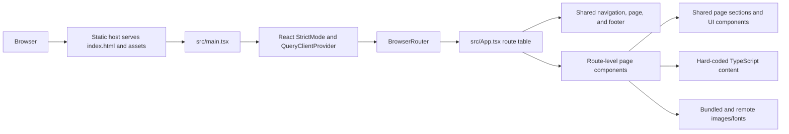

# Architecture

## Application shape

Social Bond is a browser-rendered React single-page application (SPA) built by Vite. It serves hard-coded marketing pages and local static assets. There is no backend, database, authentication service, or API client in the current source.

## Startup and route flow

1. The static host returns `index.html` for the site entry and SPA route fallback.
2. `src/main.tsx` imports global styles, creates the React root, and mounts `App` inside `React.StrictMode`, a TanStack Query client provider, and React Router's `BrowserRouter`.
3. `src/App.tsx` declares the route table using React Router. It also renders the shared navigation, scroll-to-top behavior, footer, and a catch-all not-found page.
4. Route-level components in `src/pages/` compose page sections from `src/components/sections/`, UI primitives from `src/components/ui/`, and hard-coded content from `src/data/`.
5. Vite compiles TypeScript/React and Tailwind styles into the static `dist/` output.

## Routing migration compatibility

The active route table is in `src/App.tsx` and uses `react-router-dom`. Some source files still import `Link` and `createFileRoute` from `@tanstack/react-router`; `vite.config.ts` aliases that package to `src/lib/router-shim.tsx`.

The shim maps `Link` to React Router's `NavLink`, but several other exports are compatibility no-ops or partial wrappers. Route declarations exported by old page modules are not the active route table. Do not rely on TanStack Router loaders, route metadata, navigation options, or invalidation unless the migration is completed and those APIs are implemented.

## Code areas

- `src/main.tsx`: browser entry point and top-level providers.
- `src/App.tsx`: SPA route table and shared layout.
- `src/pages/`: route components and page-specific sections.
- `src/components/sections/`: shared marketing content, navigation, and footer.
- `src/components/ui/`: reusable Radix-based components.
- `src/data/site-pages.ts`: hard-coded page descriptions and navigation data.
- `src/lib/`: shared utilities and the router compatibility shim.
- `src/styles.css`: global styles, Tailwind entry, and theme styling.
- `public/` and `src/assets/`: local image, logo, and favicon files.

## State and external requests

The active persistent browser state identified in source is the light/dark theme preference in `localStorage`. The TanStack Query provider is mounted, but no backend query or mutation workflow is currently connected. The contact form only updates in-memory component state and does not submit to a server.

`index.html` loads Google Fonts, and many page sections request remote Unsplash or avatar images. Those resources are fetched by visitors' browsers. Confirm availability, licensing, privacy disclosures, and any required fallbacks before production.

## Current limitations

- Route-specific components are client-rendered; the current setup has no server-side rendering or API.
- Static policy text is not a cookie-consent mechanism or evidence of implemented analytics.
- A number of routes marked as services, portfolio, case studies, testimonials, quote, and consultation currently show an under-construction matching game.
- Contact submission and meeting booking are not connected to external or server-side services.
- `index.html` contains the document-level metadata; the router shim does not provide active route-level head management.

See [HTTP routes](api.md), the [README](../README.md), and the [Roadmap](../ROADMAP.md) for current behavior and planned work.
