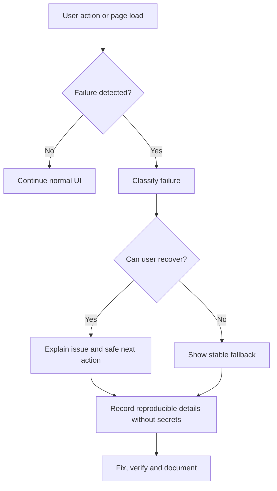

# 🚦 Error Handling and Recovery

## Current application boundaries

The current application is a browser-side React SPA. Its visible failure surfaces include route-not-found handling, browser/network failures for remote assets, invalid user input and runtime errors. There is no server API whose error contract can be documented today.

## Error categories

| Category | Example | Expected user experience | Engineering response |
|---|---|---|---|
| Navigation | Unknown path | Branded 404 with route back to home | Verify route table and SPA fallback |
| Form validation | Missing required value | Inline field guidance | Keep labels and errors associated |
| Local UI runtime | Component throws | Avoid blank or misleading UI | Add error boundaries and capture actionable diagnostics |
| Remote asset | Image/font request fails | Layout remains usable with fallback | Use dimensions, alt text and local fallback |
| Build/deploy | Build or static host failure | Release is not promoted | Inspect CI logs and restore last known-good artifact |

## Error handling flow

## Rules for future network operations

When a real API is introduced:
- distinguish validation, authorization, rate-limit, timeout and server errors;
- never show raw stack traces, secrets or internal infrastructure details;
- use request identifiers for support correlation, not personal data;
- provide retry only for operations that are safe to retry;
- prevent duplicate lead submissions with an idempotency strategy where appropriate;
- log only necessary diagnostic metadata and define retention;
- test offline, timeout, malformed response and server failure cases.

## Incident response

For a suspected security or privacy incident, stop risky releases, preserve relevant logs, restrict access and follow [Incident Response](incident-response.md). Do not put sensitive incident details in a public issue.
