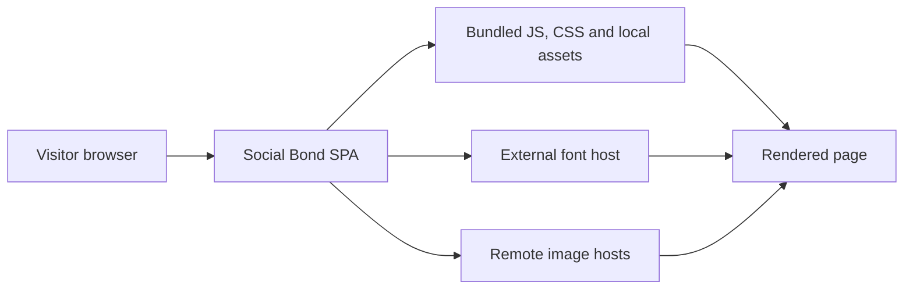

# 🔌 External Dependencies and Browser Requests

## Dependency categories

The application is built with React, TypeScript, Vite, Tailwind CSS, React Router DOM, Radix UI packages and supporting libraries declared in `package.json`. The committed `bun.lock` is the dependency resolution source for Bun installs.

The site also references remote visual resources, including Google Fonts and remote image/avatar hosts in page components. Those resources are requested directly by the visitor's browser.

## Trust and availability boundaries

| Dependency class | Why it matters | Review action |
|---|---|---|
| npm packages | Supply-chain, maintenance and vulnerability exposure | Review updates, advisories and lockfile changes |
| Google Fonts | Third-party network request and availability dependency | Review privacy disclosure, fallback fonts and licensing |
| Remote image hosts | Availability, performance, privacy and content rights | Prefer owned/optimized assets for critical visuals |
| Browser storage | User preference persistence on the device | Handle unavailable storage and avoid storing sensitive data |

## Third-party request flow

## Operational recommendations

- Add fallbacks for remote fonts and noncritical images.
- Avoid loading third-party resources before they are needed.
- Do not include personal information in external resource URLs.
- Review image and font licensing before production use.
- Consider self-hosting critical assets to improve availability and reduce third-party requests.
- Add a Content Security Policy only after inventorying all required origins; an overly strict policy can break the site, while an overly broad policy provides little protection.
- Re-review dependencies on security advisories and major version updates.

## Current limitations

No CRM, calendar, payment, analytics, authentication or server API integration is established by the current application source. Installed libraries alone are not evidence that a service is connected.
