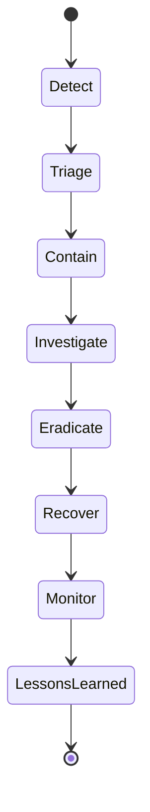

# 🚨 Incident Response

This runbook structures response to security, deployment, availability, and visitor-data incidents. It is not a 24/7 response commitment. There is no defined on-call rotation or guaranteed SLA.

## Categories
| Category | Examples |
| --- | --- |
| Security | Exposed deployment token, compromised dependency, unauthorized repository change |
| Availability | Site unavailable, broken SPA fallback, failing assets |
| Integrity | Modified content, unapproved imagery, tampered release |
| Privacy | Future form data sent to wrong recipient, accidental disclosure |
| Accessibility | Release blocks keyboard or screen-reader use |

## Response lifecycle

## First response
1. Capture time, public URL, route, commit/release, browser, and impact.
2. Do not publish credentials, private data, or exploit details.
3. If deployment is compromised, stop releases and restrict affected credentials.
4. Revoke or rotate exposed secrets through the provider. Deleting a value from the latest commit is insufficient.
5. Preserve logs/evidence securely with limited access.
6. Restore a known-good artifact when safe.
7. Determine whether personal information was actually transmitted or exposed.

Use private vulnerability reporting in SECURITY.md. Legal notification obligations require assessment by the responsible organization with qualified counsel. Post-incident review records impact, timeline, cause, containment, recovery, data exposure, owners, and new controls. Use [incident report template](templates/incident-report-template.md).