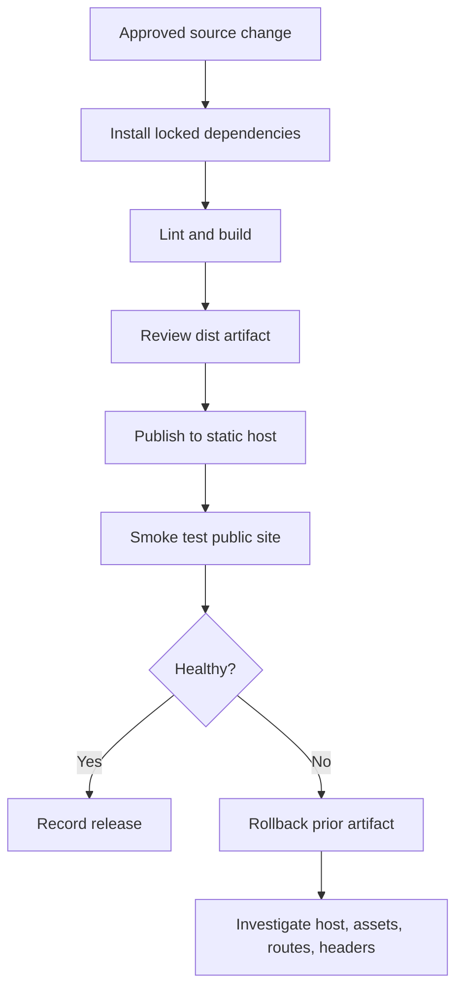

# ⚙️ Operations Runbook

## Runtime model
Production is a static Vite frontend. There is no app process, worker, database, or API to operate. The hosting provider serves generated dist/.

## Operational flow

## Pre-release
- Correct branch and reviewed commit.
- Frozen Bun install succeeds.
- Lint and production build succeed.
- Route list matches src/App.tsx.
- Direct route refresh works on target host.
- No broken asset paths or unexpected remote requests.
- No private credentials in repository or bundle.
- Policy text and external integrations reviewed.
- Rollback artifact retained.

## Health checks
Verify home over HTTPS; open and refresh /about; load static image and CSS with expected content types; check contact messaging is honest; verify navigation and 404; inspect console; verify public security headers. The repo defines no uptime target, monitoring provider, alert route, or on-call rotation.

## Rollback
Identify last known-good artifact/commit, restore using host rollback, verify origin and nested routes, record impact/timeline, preserve redacted logs, and open a follow-up issue. Treat hosting compromise or secret exposure as a security incident. See [incident response](incident-response.md).