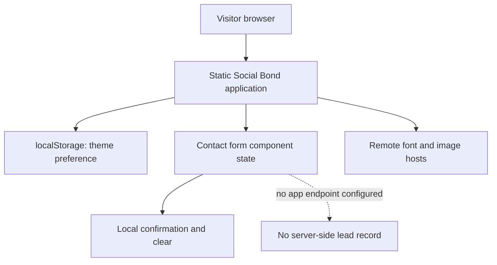

# 🔐 Privacy and Data Inventory

## Purpose

This inventory describes the data handling that can be established from the current frontend source. It is not legal advice and does not replace review of hosting logs, provider configuration or the published privacy notice.

## Current data inventory

| Data / signal | Current location | Lifetime | Transmission established by app source? |
|---|---|---|---|
| Contact form values | React component state while editing | Until component state is cleared/unmounted | No application submission request identified |
| Theme preference | Browser `localStorage`, key `theme` | Until user/browser clears it | Browser-local |
| Static page content | Bundled JS/HTML assets | Build/deployment lifetime | Delivered to every visitor |
| Remote font/image requests | Visitor browser and third-party host | Provider-defined request logs/cache | Yes, browser makes external requests where referenced |
| Server access logs | Hosting provider | Provider-configured | Not inspectable from this repository |

## Data flow

## Privacy risks and controls

- Do not collect sensitive personal information through a form that does not transmit data.
- Do not describe a local confirmation as a delivered message.
- Review the hosting provider's access logs, retention and subprocessors separately.
- Disclose remote font/image requests where required by applicable law and policy.
- Keep future analytics and advertising integrations disabled until consent and disclosure requirements are assessed.
- If lead capture is implemented, document purpose, fields, recipients, retention, deletion, access controls and processor relationships before release.

## Review triggers

Revisit this inventory whenever the app adds analytics, cookies beyond essential browser preferences, a CRM, a booking provider, newsletter subscription, authentication, user uploads, server-side forms or any other personal-data processing.
