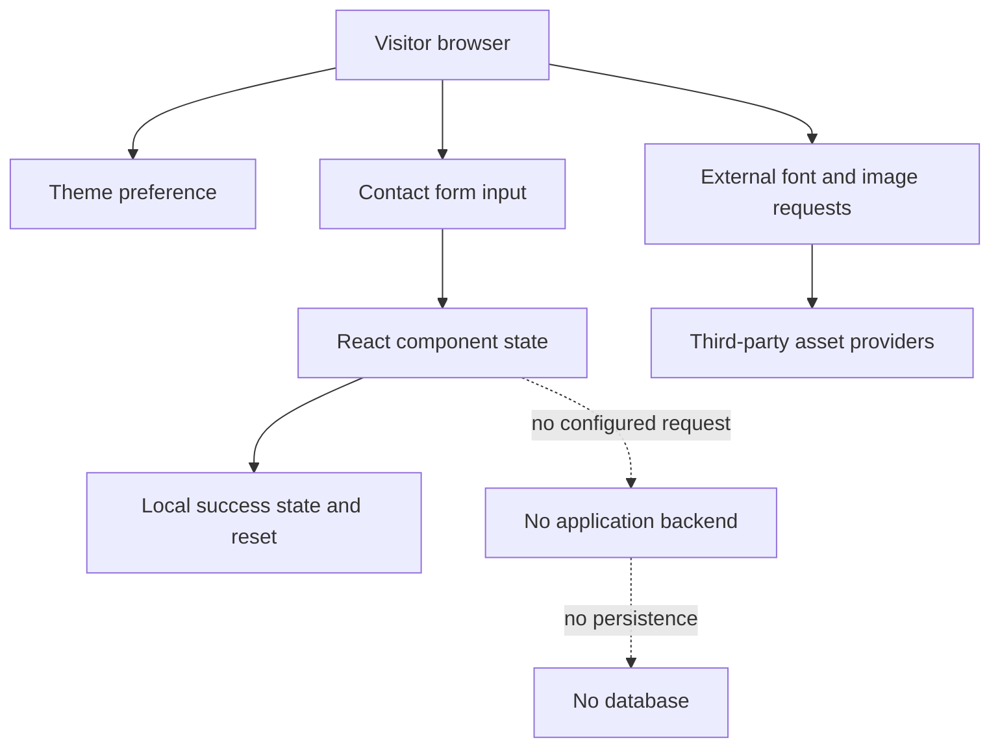

# 🔐 Privacy and Data Handling

## Current browser behavior
- Theme preference is stored in browser localStorage.
- Contact form values live in React component state and are cleared after the local submit interaction.
- The inspected submit handler does not make an HTTP request or persist form content.
- Google Fonts and remote images are requested from visitors' browsers where referenced.
- No cookie-consent manager or analytics integration was identified in inspected entry points.
- Static policy pages do not enforce consent or privacy requests.

## Data flow

## Review before collecting leads
1. Identify data controller and purpose for each field.
2. Collect only necessary fields and mark optional fields.
3. Select and contract with the submission processor.
4. Define secure transmission, access, retention, deletion, and incident procedures.
5. Present a notice at the point of collection.
6. Update privacy policy to match actual processing and recipients.
7. Review cross-border processing and applicable obligations with qualified counsel.
8. Test that the form never displays success when delivery fails.

Remote assets can disclose request metadata to providers. Consider self-hosting licensed assets and limiting external hosts. Until a real submission endpoint exists, do not encourage confidential information through the prototype form. This is not legal advice.