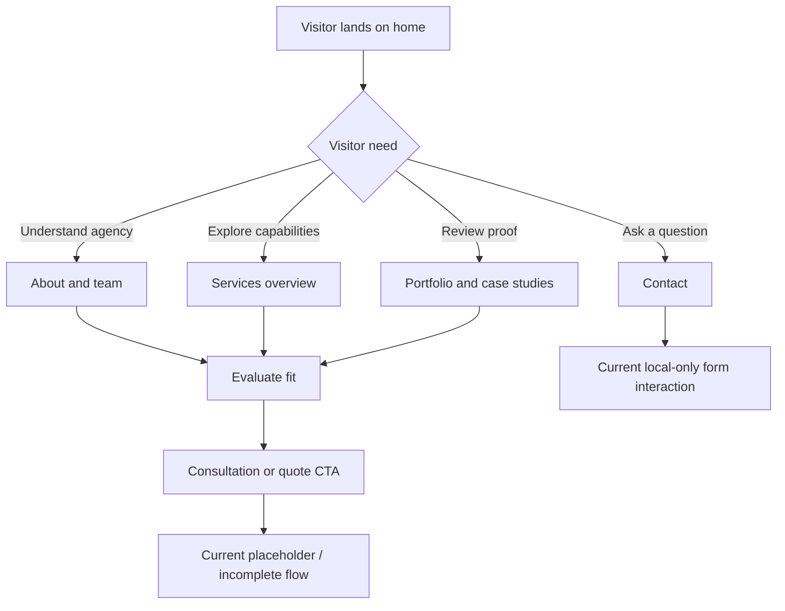

# 🎯 Product Overview

## 1. Purpose

Social Bond is presented as a creative growth partner for brands, creators, startups, and businesses. Public copy describes video editing, social media management, influencer management, content strategy, and digital marketing. The website's role is to explain the offering, establish credibility, and encourage contact.

The repository is named `bondforge-studio`; the site title, page copy, and metadata use the Social Bond brand.

## 2. Intended visitor journey

This diagram describes the intended marketing journey, not an assertion that every step works today.

## 3. Current capability matrix

| Capability | Current behavior | Not implemented |
| --- | --- | --- |
| Home | Renders composed marketing sections | No CMS or server-driven content |
| About | Renders company/team content | No CMS workflow |
| Service overview | Presents service categories | No service fulfilment workflow |
| Contact | Browser validation, temporary local success state | No request submission, email delivery, or persistence |
| Consultation | Prototype experience | No calendar availability or booking |
| Quote | Placeholder interaction | No quote intake or proposal generation |
| Portfolio/case studies/testimonials | Placeholder experience | No content management or operational proof workflow |
| Policies | Static copy | No consent manager or privacy request handling |
| Theme | Stores preference in browser local storage | No cross-device synchronization |

## 4. Audience and content principles

The site should communicate clearly without promising outcomes that cannot be substantiated. Case studies, testimonials, performance figures, client logos, and named claims require permission and evidence. Replace sample or aspirational values with approved material before launch.

## 5. Product status and non-goals

This repository currently represents a frontend prototype/in-progress marketing website. It is not a CRM, lead-management system, customer portal, booking service, quote engine, analytics platform, or secure client-document exchange.

## 6. Launch gates

1. Connect contact submissions to a trusted backend or approved provider.
2. Implement actual consultation booking or remove booking affordances.
3. Replace placeholder routes with approved content or remove misleading navigation links.
4. Add server-side validation, abuse prevention, delivery failure handling, and retention controls.
5. Review privacy notices against real collection, processors, hosting logs, and third-party requests.
6. Run keyboard, screen-reader, mobile, route-refresh, and production-build checks.
7. Confirm claims, imagery, trademarks, and testimonials are authorized.

See [Roadmap](../ROADMAP.md) and [Risk Register](risk-register.md).