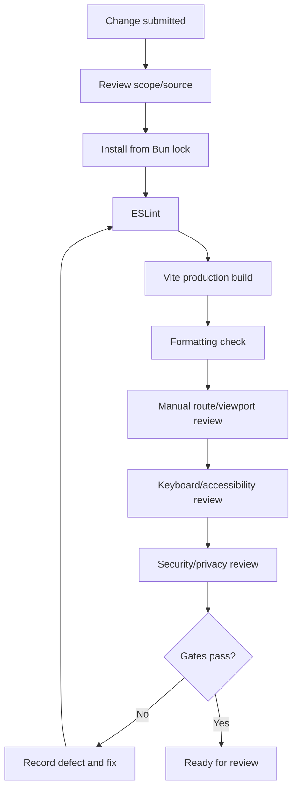

# 🧪 Quality Assurance Plan

## Current verification scripts
- `bun run lint`: ESLint.
- `bun run build`: production Vite build.
- `bun run build:dev`: development-mode build.
- `bun run preview`: preview an existing build locally.
- `bunx prettier --check .`: formatting check without rewriting.

There is currently no test script or automated unit, component, browser, or end-to-end suite. Do not claim automated test coverage.

## Quality gates

## Regression matrix
| Area | Minimum verification |
| --- | --- |
| Home | Load, scroll, images, CTA destinations |
| About | Sections, team imagery, responsive layout |
| Services | Overview and each detail route |
| Contact | Required fields, labels, local success wording |
| FAQs | Accordion keyboard behavior and state |
| Policies | Direct load, readable text, internal links |
| Navigation | Desktop/mobile, active link, keyboard focus |
| Theme | Toggle, persistence, system default |
| 404 | Unknown path renders not-found content |
| Hosting | Direct load and refresh nested routes |
| Assets | No 404s, correct MIME, useful alt text |

Test narrow mobile, tablet, and wide desktop. Check overflow, sticky header overlap, image crops, text width, hit targets, contrast, reduced motion. Use [QA test template](templates/qa-test-case-template.md).