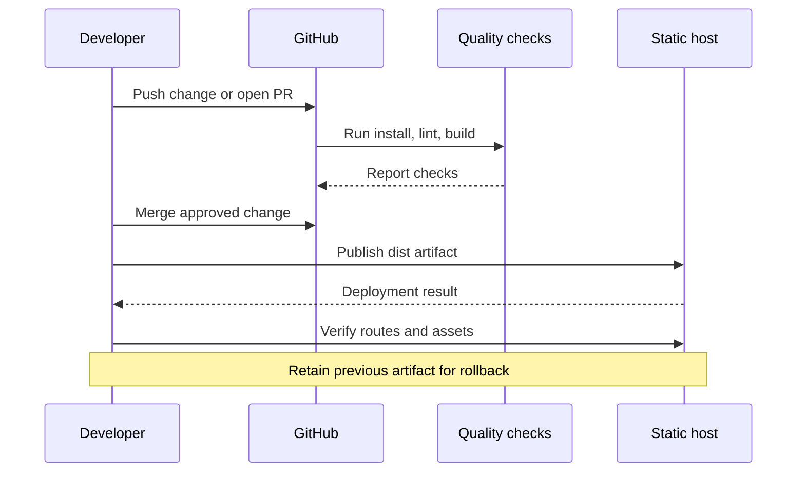

# 🚀 Release Management

## Model
A release is a reviewed source revision plus Vite-generated dist/ output deployed to a static host. The repository does not currently define semantic version tags, a production deploy workflow, or artifact retention.

## Release sequence

Use meaningful release tags for public milestones and record user-visible changes in CHANGELOG.md. Do not invent dates or declare release based only on documentation commits.

## Checklist
- [ ] Reviewed source change and accepted risk.
- [ ] Frozen install succeeds.
- [ ] Lint and production build succeed.
- [ ] Manual route, responsive, keyboard, and 404 smoke tests complete.
- [ ] External assets and policy copy reviewed.
- [ ] No private values appear in client bundle.
- [ ] Prior artifact or rollback path exists.
- [ ] Changelog and docs updated.
- [ ] Public URL and nested routes verified.

Use [release checklist template](templates/release-checklist.md).