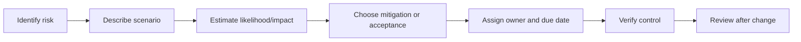

# 📊 Engineering Risk Register

Ratings are qualitative and should be revisited before launch.

| ID | Risk | Likelihood | Impact | Priority | Mitigation |
| --- | --- | --- | --- | --- | --- |
| R-01 | Contact form implies delivery without sending data | High | High | Critical | Implement real workflow or label prototype |
| R-02 | Consultation/quote routes imply workflows that are placeholders | High | High | High | Implement integrations or remove misleading CTAs |
| R-03 | Nested route refresh fails without SPA fallback | Medium | High | High | Configure and verify host |
| R-04 | Router shim hides incomplete migration semantics | Medium | Medium | Medium | Migrate imports and remove shim after tests |
| R-05 | Static policies may not reflect actual processing | Medium | High | High | Privacy/legal review before collection |
| R-06 | Remote assets disclose metadata and add dependencies | Medium | Medium | Medium | Minimize providers or self-host licensed assets |
| R-07 | No automated test suite | High | Medium | High | Add route/component/browser tests |
| R-08 | Client environment secrets could be exposed | Medium | High | High | Keep secrets server-side; scan build output |
| R-09 | Accessibility defects in interactive components | Medium | High | High | Automated and manual keyboard/AT checks |
| R-10 | Hosting headers/account controls undocumented | Unknown | High | High | Audit live deployment |

## Review lifecycle

Documentation does not resolve a risk by itself. Controls must be implemented and verified in runtime, workflow, or hosting. Record owners for accepted high-impact risks.