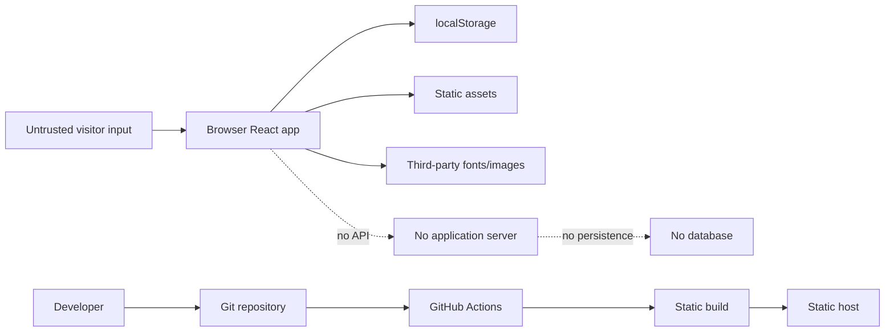

# 🛡️ Security Engineering Guide

This React/Vite application has no backend, authentication service, database, or server-side form endpoint in the repository. This guide records controls to apply; it is not a penetration-test report or certification.

## Trust boundaries

## Threats and controls
| Threat | Example | Mitigation |
| --- | --- | --- |
| Secret exposure | Private token in Vite variable | Keep privileged secrets server-side; scan bundles |
| Dependency compromise | Vulnerable/malicious package | Review dependency and lockfile updates |
| Unsafe HTML | Untrusted content injected into HTML | Avoid raw HTML sinks; sanitize if unavoidable |
| Form abuse | Bots attack future lead endpoint | Server validation, rate limits, abuse monitoring |
| Data leakage | Free-text logged | Minimize and redact logs |
| Misleading success | UI claims delivery without sending | Implement delivery semantics or label prototype |
| Third-party requests | Remote assets expose metadata | Minimize and document providers |
| Hosting weakness | Missing headers or exposed files | HTTPS, CSP, secure headers, restricted root |

## Secure development requirements
- Never commit passwords, API keys, signing keys, or deployment credentials.
- Treat all Vite-exposed environment variables as public.
- Validate untrusted input at server boundaries once a server exists.
- Keep dependencies and bun.lock reviewed together.
- Use least privilege for workflows and deployment access.
- Keep private data and vulnerability details out of public issues.
- Review external assets and configure CSP from actual requests.

## Static hosting baseline
Enforce HTTPS; use a restrictive CSP with explicit resource sources; configure X-Content-Type-Options, Referrer-Policy, and frame-ancestors; disable unused browser capabilities; expose only dist/; restrict hosting access; and review caching across releases. Use private vulnerability reporting in [SECURITY.md](../SECURITY.md).