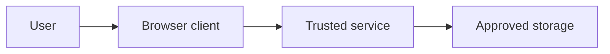

# Threat Assessment: <Change or integration>

- **Owner:** <role>
- **Date:** YYYY-MM-DD
- **Routes affected:** <paths>
- **Data classes:** Public | Internal | Personal | Sensitive
- **External providers:** <names or none>

## Change summary
Describe feature and reason.

## Data flow

Replace with actual flow and remove non-existent components.

## Assets and trust boundaries
List data, credentials, sessions, deployment credentials, and third-party systems touched.

## Threat scenarios
| Threat | Attack path | Impact | Likelihood | Mitigation | Evidence |
| --- | --- | --- | --- | --- | --- |
| <Threat> | <Path> | <Impact> | <Rating> | <Control> | <Test/link> |

## Privacy assessment
- What personal data is collected?
- Why is each field necessary?
- Where does data go and which processors receive it?
- How long is it retained?
- How can users request deletion/correction?
- What notice/consent is presented?

## Controls
- [ ] Server validation
- [ ] Authentication/authorization if required
- [ ] Abuse/rate limiting
- [ ] Secret management
- [ ] Logging minimization/redaction
- [ ] HTTPS and secure headers
- [ ] Dependency review
- [ ] Failure and incident path
- [ ] Keyboard/focus behavior
- [ ] Form labels/errors
- [ ] Contrast/reduced motion

## Residual risk and approval
List accepted risks, owner, review date, and evidence required before release.