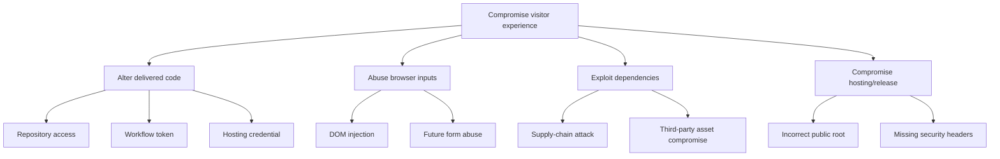

# 🧨 Threat Model

## Scope and assumptions
Scope includes browser application, static assets, local browser state, third-party font/image requests, repository workflow, build output, and potential future lead-intake features. This is a design assessment, not a penetration test. Browser inputs and client bundles are untrusted/public. Hosting configuration is external and requires separate review.

## Assets
| Asset | Security objective |
| --- | --- |
| Source and build process | Integrity and availability |
| Hosting/deployment credentials | Confidentiality and integrity |
| Public content and assets | Integrity and availability |
| Future visitor input | Confidentiality, integrity, retention |
| Brand/client proof | Permission and accuracy |
| Dependency lockfile | Integrity and reproducibility |

## Actors
Anonymous visitor, automated bot, malicious visitor entering crafted text/URLs, compromised asset provider, compromised dependency, malicious contributor, compromised workflow token, or hosting-account attacker.

## Attack tree

## STRIDE assessment
| Category | Scenario | Priority |
| --- | --- | --- |
| Spoofing | Fake lead/booking confirmation | Medium |
| Tampering | Unauthorized source/deployment change | High |
| Repudiation | No server receipt/audit record | Medium |
| Information disclosure | Secret in client bundle; asset request metadata | High |
| Denial of service | Host request flood; future form spam | Medium |
| Elevation of privilege | Overprivileged workflow/host account | High |

Ratings are qualitative judgments, not measured likelihood. Mitigate with reviewed changes, least privilege, lockfile review, secret scanning, HTTPS/security headers, CSP, minimized third parties, safe DOM handling, and server controls before collecting leads. Revisit when adding backend/API, auth, analytics, uploads, CMS, or deployment automation. Use [threat assessment template](templates/threat-assessment-template.md).