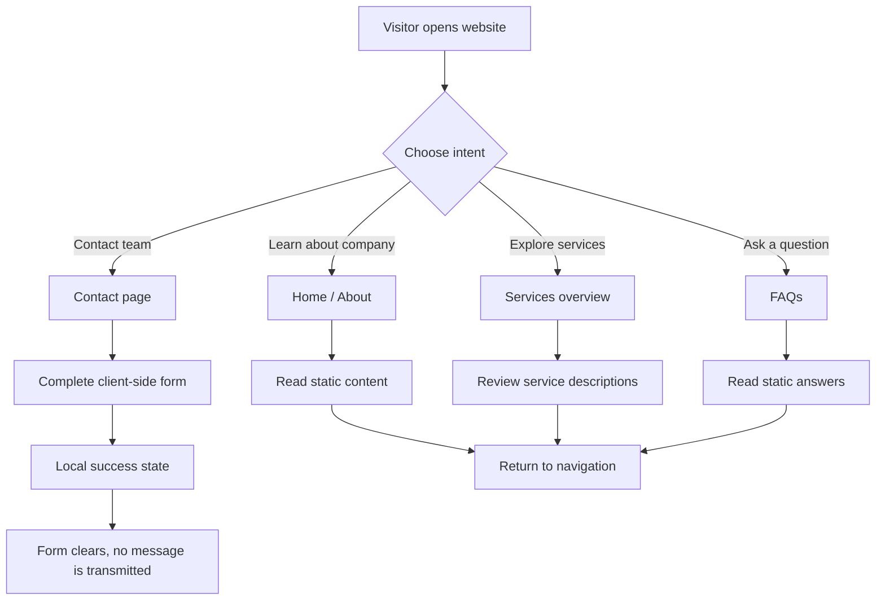
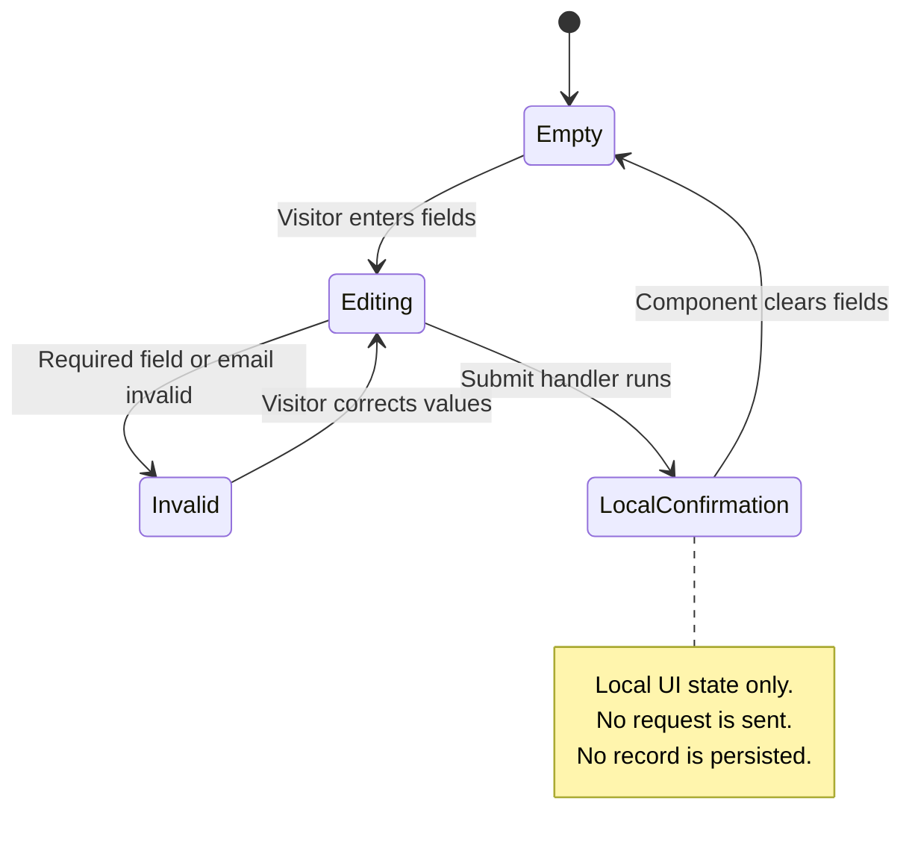

# 🧭 Visitor Journeys and Interaction Boundaries

This document records the journeys implied by the current Social Bond website. It distinguishes visible interface flows from services that are not connected.

## Journey map

## Journey catalogue

| Journey | Entry route | Current outcome | Important limitation |
|---|---|---|---|
| Understand the company | `/`, `/about` | Read static marketing and company content | Content is bundled with the frontend |
| Explore services | `/services` | Read the services overview | Several detail routes are prototypes |
| Ask a common question | `/faqs` | Read static FAQ content | No support ticket is created |
| Contact the team | `/contact` | Client-side validation and local confirmation UI | No HTTP request, email or persistence |
| Request a quote | `/request-a-quote` | Under-construction experience | No quote request workflow |
| Book a consultation | `/free-consultation` | Under-construction experience | No calendar availability or booking provider |
| Review proof of work | `/portfolio`, `/case-studies`, `/testimonials` | Under-construction experience | No verified case-study or testimonial workflow |

## Contact form state flow

## UX requirements for future implementation

A production lead workflow must not be represented by a decorative success state. Before connecting submission:
- define the receiving service and data owner;
- validate input on both client and server;
- add rate limiting and abuse controls on the server;
- provide a truthful pending, success and failure state;
- prevent accidental duplicate submission;
- publish retention, deletion and contact details;
- add end-to-end tests for success, validation and failure;
- ensure keyboard and screen-reader announcements cover status changes.

## Accessibility checkpoints

- Preserve a logical heading order and landmarks.
- Ensure all links and controls work without a pointer.
- Give form fields visible labels and associated error messages.
- Announce asynchronous or local status changes with an appropriate live region.
- Keep focus visible after validation and modal interactions.
- Test at narrow widths, 200% zoom and reduced-motion preference.

See [Accessibility](accessibility.md) and the [QA guide](qa.md).
